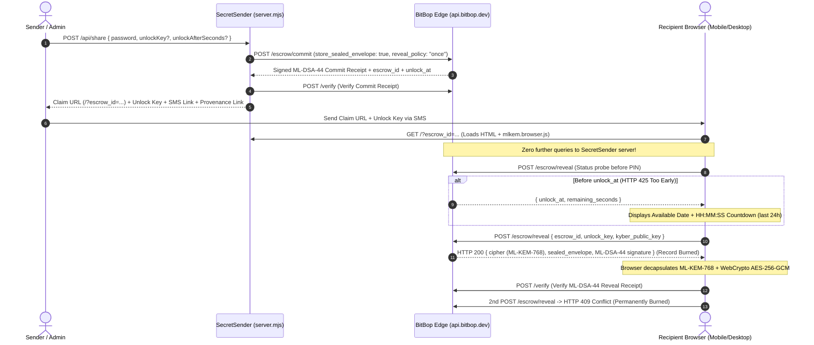

# SecretSender

**SecretSender** is a lightweight, zero-storage one-time password and secret sharing web application — **powered by [BitBop](https://www.bitbop.dev)**.

It lets an administrator or sender seal a sensitive password (with an optional PIN and an optional **Future Reveal Date / Time**), share the Claim URL and Unlock Key via native mobile SMS or clipboard, and allows the recipient to unseal and verify the secret once in their browser using **NIST FIPS 203 `ML-KEM-768`** + **WebCrypto `AES-256-GCM`** + **NIST FIPS 204 `ML-DSA-44`** provenance receipts.

---

## Key Features

1. **Zero Local Database (Hardware-Backed Burn-on-Read)**
   - Secrets (`≤512 bytes`) are sealed in BitBop hardware escrow (`reveal_policy: "once"`, `store_sealed_envelope: true`) using 32 bytes of NIST SP 800-90B verified physical hardware quantum entropy.
   - Wrong PIN attempts return `HTTP 403 Forbidden` **without** burning the secret (protected by per-IP PBKDF2-HMAC-SHA256 exponential backoff).
   - The first valid reveal permanently burns the escrow record; any subsequent attempt returns `HTTP 409 Conflict`.

2. **Future Reveal Date & Final 24-Hour `HH:MM:SS` Countdown (Zero URL Side-Channel)**
   - Senders can configure an immediate reveal or any future reveal date/time (`unlock_after_seconds`).
   - The generated Claim URL carries **only** `?escrow_id=<uuid>` — no side-channel dates or keys are leaked in the URL.
   - When a recipient opens a time-locked Claim URL before `unlock_at`:
     - Their browser queries `https://api.bitbop.dev/escrow/reveal` (`HTTP 425 Too Early`) to retrieve the authoritative `unlock_at` timestamp.
     - Displays the exact **Available Date & Time**.
     - During the **final 24 hours (`<= 86,400s`)**, displays a live ticking **`HH:MM:SS` countdown clock** (`23:59:59` $\rightarrow$ `00:00:00`).
     - If the recipient pre-enters their Unlock Key while the countdown is running, the browser **automatically** decrypts and displays the secret at `00:00:00`.

3. **Zero Further Queries to the App Server on Reveal**
   - Once the Claim page (`/?escrow_id=...`) loads in the recipient's browser, **zero HTTP requests are sent back to the `SecretSender` server** to check the countdown, decrypt the secret, or verify provenance.
   - The recipient's browser generates an ephemeral **`ML-KEM-768`** keypair, calls `https://api.bitbop.dev/escrow/reveal` directly, decapsulates the 32-byte hardware entropy key, decrypts the `AES-256-GCM` envelope in `window.crypto.subtle`, and verifies the **`ML-DSA-44`** signature against `https://api.bitbop.dev/verify`.

4. **Mobile-First SMS & Provenance Verification**
   - Includes a one-tap **`Send via SMS`** (`sms:?body=...`) link that opens the phone's native messaging app pre-populated with the Claim URL, Unlock Key, and a deep-link to [`https://www.bitbop.dev/provenance`](https://www.bitbop.dev/provenance) so the recipient can independently audit the hardware beacon block and receipt signature.

---

## How It Works



---

## Quick Start (Local Development)

### Prerequisites
- **Node.js** `>= 20.0.0`

### Run Locally
```bash
git clone https://github.com/Pointhairedboss/SecretSender.git
cd SecretSender
npm install
npm start
```

Open **`http://localhost:5179`** in your browser.

> **Zero-Config API Key Provisioning**: If `BITBOP_API_KEY` is not set in your environment, `server.mjs` automatically self-provisions a Free Tier BitBop API key (`bb_free_...`, 500 requests/day, 60-day TTL) via `POST https://api.bitbop.dev/api/keys/free` using `ML-KEM-768` on startup.

### Testing on a Physical Android Phone over USB (ADB)
```bash
adb reverse tcp:5179 tcp:5179
adb shell am start -a android.intent.action.VIEW -d "http://localhost:5179" com.android.chrome
```

---

## Deployment Guide

### Environment Variables

| Variable | Default | Description |
| :--- | :--- | :--- |
| `PORT` | `5179` | HTTP port to listen on |
| `HOST` | `127.0.0.1` | Bind address (`0.0.0.0` for containers/VPS) |
| `BITBOP_API_KEY` | *(auto-minted)* | Your BitBop API key (`bb_free_...` or `bb_live_...` from [`bitbop.dev/get-key`](https://www.bitbop.dev/get-key)) |
| `PUBLIC_ORIGIN` | *(auto-detected)* | Optional public base URL override (e.g. `https://secrets.example.com`) |

### Option 1: Linux VPS / systemd + Reverse Proxy (Caddy / Nginx / Cloudflare Tunnel)
1. Clone into `/opt/secret-sender` and install dependencies:
   ```bash
   git clone https://github.com/Pointhairedboss/SecretSender.git /opt/secret-sender
   cd /opt/secret-sender && npm ci --omit=dev
   ```
2. Run under `systemd` (or PM2) bound to `127.0.0.1:5179` with your `BITBOP_API_KEY`:
   ```ini
   [Unit]
   Description=SecretSender One-Time Password Service
   After=network.target

   [Service]
   Type=simple
   WorkingDirectory=/opt/secret-sender
   Environment=HOST=127.0.0.1
   Environment=PORT=5179
   Environment=BITBOP_API_KEY=bb_live_your_key_here
   ExecStart=/usr/bin/node /opt/secret-sender/server.mjs
   Restart=always

   [Install]
   WantedBy=multi-user.target
   ```
3. Point Caddy, Nginx, or `cloudflared` to `http://127.0.0.1:5179` with HTTPS enabled (HTTPS or `localhost` is required by browsers to expose `window.crypto.subtle` WebCrypto).

### Option 2: Fly.io / Render / Railway / Docker
Run with `HOST=0.0.0.0`:
```dockerfile
FROM node:22-alpine
WORKDIR /app
COPY package*.json ./
RUN npm ci --omit=dev
COPY server.mjs mlkem.browser.js ./
ENV HOST=0.0.0.0 PORT=5179
EXPOSE 5179
CMD ["node", "server.mjs"]
```

---

<p align="center">
  <a href="https://www.bitbop.dev">powered by <strong>BitBop</strong></a>
</p>
